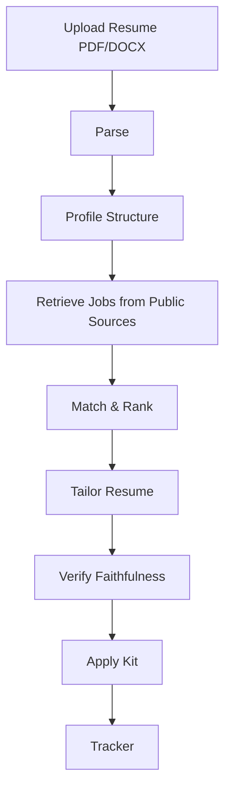

# Architecture (Planned)

## Pipeline

## LangGraph Node Plan
- `upload`: Receive resume, validate file type
- `parse`: Extract text (pypdf/python-docx)
- `build_profile`: Structure into Profile schema with stable IDs
- `fetch_jobs`: Query public ATS APIs (Greenhouse, Lever, Ashby, Adzuna, RemoteOK)
- `match`: Score and rank jobs
- `retrieve_context`: RAG for job retrieval and tailor grounding
- `tailor`: Generate tailored resume using only profile facts
- `verify`: Faithfulness check against source chunks
- `apply_kit`: Generate kit (no auto-submit)
- `track`: Update application tracker

**Note:** RAG is used for job retrieval and tailor grounding, but NOT for resume parsing (resume fits in context).
