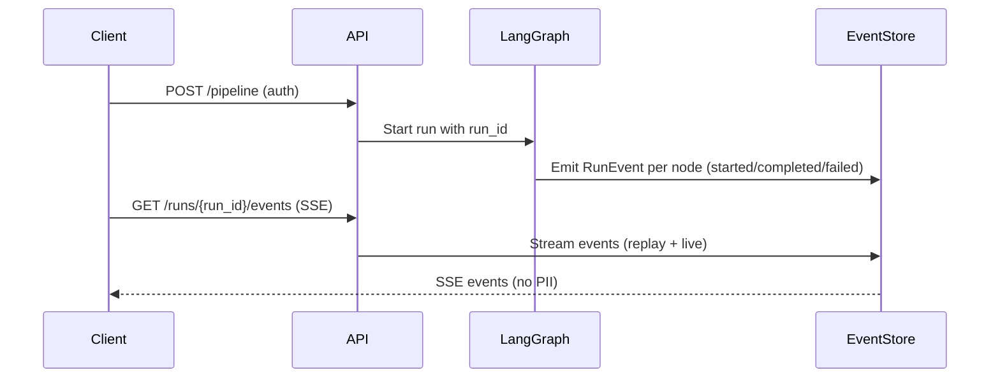

# Architecture (Planned)

## Stack

- **Frontend:** React + Vite + TypeScript, GitHub Pages (HashRouter)
- **Backend:** FastAPI in Docker on Render (free tier, 512 MB RAM)
- **Database:** Supabase Postgres via SQLAlchemy (async) + Alembic migrations
- **Auth:** Supabase Auth (email + Google), JWT verification on backend
- **File Storage:** Supabase Storage private bucket, signed URLs only
- **LLM:** OpenRouter (bring-your-own-key), hosted, fits in 512 MB
- **Embeddings/Reranker:** Hosted APIs behind `Embedder`/`Reranker` interfaces

## Pipeline
```mermaid
graph TD
    A[Upload Resume PDF/DOCX] --> B[Parse]
    B --> C[Profile Structure]
    C --> D[Fetch Jobs from Public Sources]
    D --> E[Match & Rank]
    E --> F[Retrieve Context (RAG)]
    F --> G[Tailor Resume]
    G --> H[Verify Faithfulness]
    H --> I[Apply Kit]
    I --> J[Tracker]
```

## LangGraph Node Plan
- `upload`: Receive resume, validate file type, store to Supabase Storage
- `parse`: Extract text (pypdf/python-docx), extract structured Profile via LLM
- `build_profile`: Structure into Profile schema with stable IDs
- `fetch_jobs`: Query public ATS APIs (Greenhouse, Lever, Ashby, Adzuna, RemoteOK)
- `match`: Score and rank jobs via LLM
- `retrieve_context`: RAG for job retrieval and tailor grounding
- `tailor`: Generate tailored resume using only profile facts
- `verify`: Faithfulness check against source chunks
- `apply_kit`: Generate kit (tailored resume + cover letter, no auto-submit)
- `track`: Update application tracker (per-user, RLS-scoped)

## Auth & Data Model
- Every table has `user_id` column, scoped to `auth.uid()` via Row Level Security
- Supabase JWT verified via JWKS on every protected route
- Files stored in private Supabase Storage bucket, accessed via signed URLs only
- TTL deletion for raw files; "delete my account and data" endpoint

**Note:** RAG is used for job retrieval and tailor grounding, but NOT for resume parsing (resume fits in context). No torch or cross-encoder in the production image (512 MB limit).

## Event Flow (Pipeline Live)

**Note:** Events contain only counts, timings, IDs, and verdicts. No resume/profile text.
